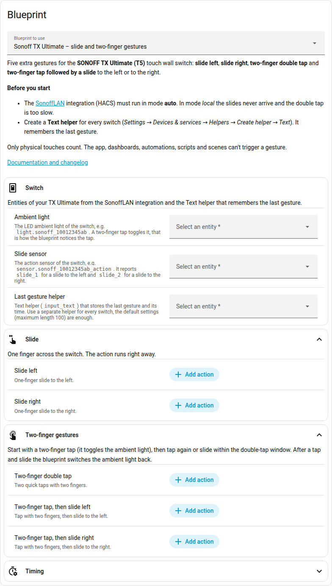
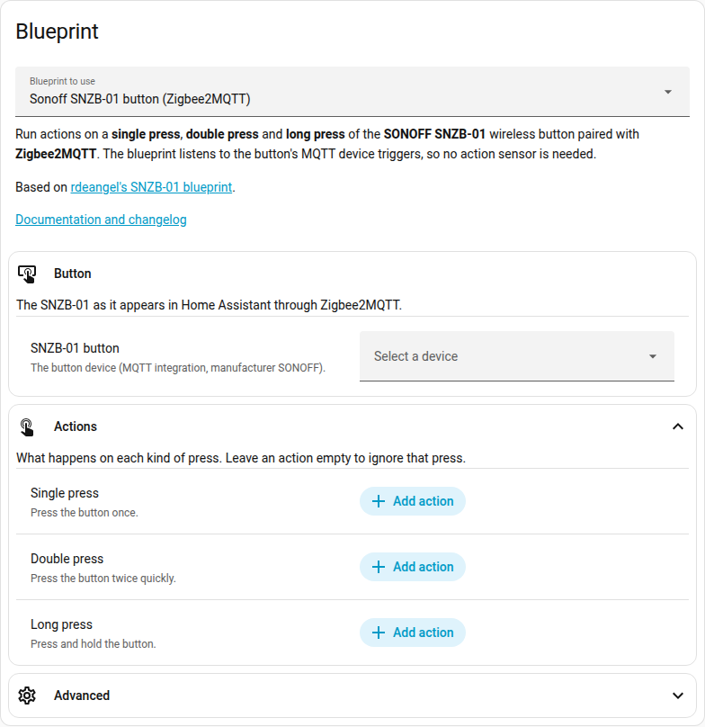
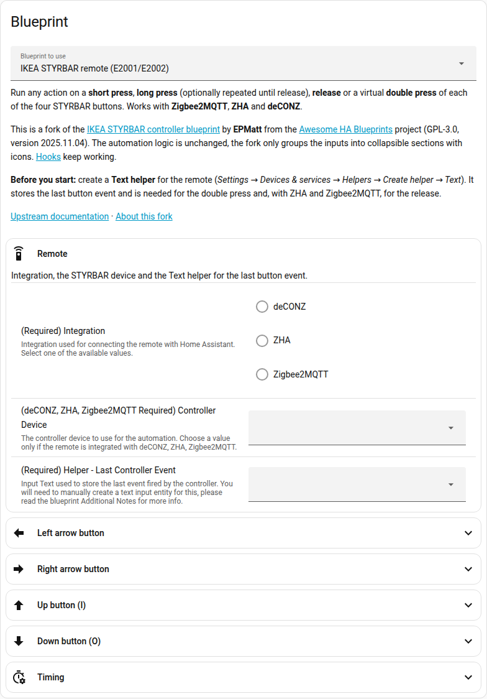
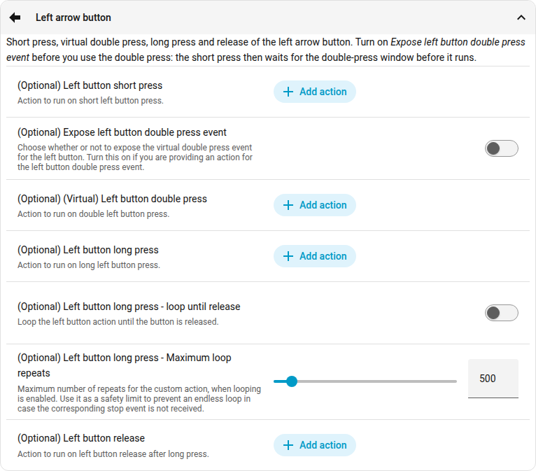
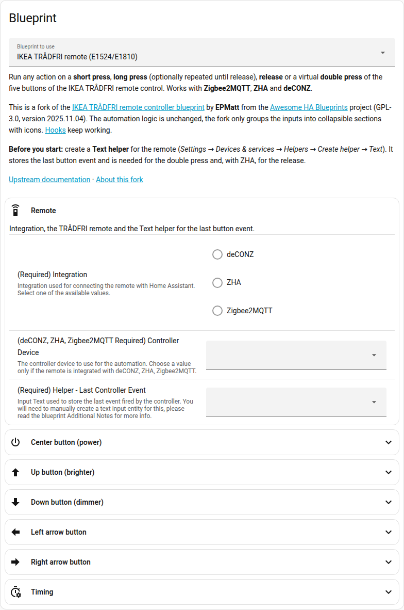

# Home Assistant Blueprints

Automation blueprints for wall switches and remotes that I use every day in my own Home Assistant.
Every change runs at home first and only then lands here.

| Blueprint | Device | Integration | Import |
|---|---|---|---|
| [Sonoff TX Ultimate – slide and two-finger gestures](#sonoff-tx-ultimate) | SONOFF TX Ultimate (T5) touch wall switch | [SonoffLAN](https://github.com/AlexxIT/SonoffLAN) (HACS) in mode **auto** |  |
| [Sonoff SNZB-01 button](#sonoff-snzb-01-button) | SONOFF SNZB-01 wireless button | Zigbee2MQTT |  |
| [IKEA STYRBAR remote](#ikea-styrbar-remote) | IKEA STYRBAR remote (E2001/E2002) | Zigbee2MQTT, ZHA, deCONZ |  |
| [IKEA TRÅDFRI remote](#ikea-tradfri-remote) | IKEA TRÅDFRI remote control (E1524/E1810) | Zigbee2MQTT, ZHA, deCONZ |  |

All blueprints need **Home Assistant 2024.10** or newer.

## Installation

1. Click **Import blueprint** next to the blueprint and confirm it in your Home Assistant.
   Without My Home Assistant: *Settings → Automations & scenes → Blueprints → Import blueprint* and paste
   the link to the `.yaml` file from this repository.
2. Open the blueprint, click **Create automation**, fill in the inputs and save.

## Updating

*Settings → Automations & scenes → Blueprints*, open the ⋮ menu next to the blueprint and choose
**Re-import blueprint**. Input names never change between versions, so your automations keep their settings.

---

## Sonoff TX Ultimate

Five extra gestures for the **SONOFF TX Ultimate (T5)** touch wall switch, each with its own action:

| Gesture | How |
|---|---|
| Slide left | Slide one finger to the left. |
| Slide right | Slide one finger to the right. |
| Two-finger double tap | Tap twice with two fingers. |
| Two-finger tap, then slide left | Tap with two fingers, then slide to the left. |
| Two-finger tap, then slide right | Tap with two fingers, then slide to the right. |

*Click the picture to see it in full size.*

### Requirements

- The **[SonoffLAN](https://github.com/AlexxIT/SonoffLAN)** integration from HACS in mode **auto** (the default).
  Check it in *Settings → Devices & services → Sonoff → Configure → Mode*. **Mode local does not work:**
  - The slides never arrive. SonoffLAN fills the action sensor only from an update that carries nothing
    but the gesture. The eWeLink cloud sends a slide exactly like that (`{"slide": 1}`), the local (LAN)
    update always carries the whole state of the switch (seen with SonoffLAN 3.13.2).
  - The two taps of a two-finger double tap arrive 1.1–2.2 s apart instead of 150–550 ms, which is
    outside the double-tap window.
- One **Text helper** for every switch: *Settings → Devices & services → Helpers → Create helper → Text*.
  The default settings are fine. The blueprint keeps the last gesture and its time in it.

### Setup

1. Create the Text helper, for example *TX bedroom – last gesture*.
2. Import the blueprint and create an automation from it.
3. In **Switch** pick:
   - **Ambient light** – the LED ambient light of the switch (`light.sonoff_<device id>`),
   - **Slide sensor** – the action sensor of the switch (`sensor.sonoff_<device id>_action`),
   - **Last gesture helper** – the helper from step 1.
4. Fill in the actions you want. Empty ones are ignored.

### How it works

- A two-finger tap toggles the ambient light of the switch. Two toggles within the double-tap window
  (1 second by default) are a **double tap**, a toggle followed by a slide is a **tap and slide**.
  After a tap and slide the blueprint switches the ambient light back, so it ends up as before.
- A slide without a two-finger tap before it runs the **slide** action right away.
- **Only physical touches count.** A change made in the app or on a dashboard (it has a user) or by an
  automation or a script (including the scenes they start) is ignored. Without this, a scene that
  flashes the ambient light would look like a double tap.
- The automation runs in `restart` mode: a new gesture stops the previous run.

### Tips and troubleshooting

- Start long-running scripts with `script.turn_on` instead of calling the script directly. A direct call
  waits for the script to finish, and the next gesture would stop it half way.
- The double tap is not recognised? Open the trace of the automation and look at the variable
  `trigger_delta` – the time in milliseconds between the two taps. If it is longer than the double-tap
  window, check that SonoffLAN runs in mode auto, or raise **Double-tap window** in the **Timing** section.

### Changelog

- **2026-10**
  - Only physical touches count: changes made in the app, by automations and by scripts are ignored.
    Before, a scene that flashed the ambient light could run the double-tap action.
  - Attribute updates of the ambient light and its return from `unavailable` are no longer taken as a tap.
  - Inputs grouped into sections with icons and descriptions, the SonoffLAN mode auto requirement
    documented. Needs Home Assistant 2024.10.
- **2024-12** – Changes of the ambient light made by automations are ignored.
- **2024-11** – The ambient light is switched back after a two-finger tap and slide.
- **2024-10** – First version. An empty or damaged helper no longer breaks the automation.

---

## Sonoff SNZB-01 button

**Single press**, **double press** and **long press** of the **SONOFF SNZB-01** wireless button paired
with **Zigbee2MQTT**. The blueprint listens to the button's MQTT device triggers, so no `action` sensor
entity is needed.

*Click the picture to see it in full size.*

### Requirements

- Zigbee2MQTT with Home Assistant discovery: the button appears as a device of the MQTT integration.

### Setup

1. Import the blueprint and create an automation from it.
2. **Button** – pick the SNZB-01 device.
3. **Actions** – fill in the single, double and long press actions. Empty ones are ignored.
4. **Advanced → Automation mode** – `parallel` by default. Choose `single` if a press should be ignored
   while the previous action is still running.

### Changelog

- **2026-10** – Presses are told apart by trigger IDs instead of the MQTT payload. Inputs grouped into
  sections with icons and descriptions, automation modes explained. `source_url` points to this
  repository, so **Re-import blueprint** updates from here. Needs Home Assistant 2024.10.
- **2026-02** – First version in this repository.

Based on [rdeangel's SNZB-01 blueprint](https://community.home-assistant.io/t/zigbee2mqtt-sonoff-wireless-switch-snzb-01-rdeangel-mod/663331).

---

## IKEA STYRBAR remote

A fork of the [IKEA E2001/E2002 STYRBAR controller blueprint](https://github.com/EPMatt/awesome-ha-blueprints/blob/main/blueprints/controllers/ikea_e2001_e2002/ikea_e2001_e2002.yaml)
by **[EPMatt](https://github.com/EPMatt)** from the **[Awesome HA Blueprints](https://epmatt.github.io/awesome-ha-blueprints)**
project. All credit for the automation logic goes to EPMatt and the contributors of that project.

**What the fork changes:** the 33 inputs are grouped into collapsible sections with icons and descriptions –
**Remote**, one section per button with all its settings (short press, double press, long press with
looping, release) and **Timing**. The automation logic is upstream version 2025.11.04 without changes, so
the [upstream documentation](https://epmatt.github.io/awesome-ha-blueprints/docs/blueprints/controllers/ikea_e2001_e2002)
and [Hooks](https://epmatt.github.io/awesome-ha-blueprints/docs/blueprints/hooks) apply as they are.

*Click a picture to see it in full size.*

### Requirements

- The remote paired through Zigbee2MQTT, ZHA or deCONZ.
- A **Text helper** for the last button event (*Settings → Devices & services → Helpers → Create helper →
  Text*). It is needed for the double press and, with ZHA and Zigbee2MQTT, for the release.

### Setup

1. Create the Text helper.
2. Import the blueprint and create an automation from it.
3. **Remote** – pick the integration, the STYRBAR device and the helper.
4. Open the section of a button and fill in its actions. To use a double press, first turn on
   *Expose … double press event*. The short press then waits for the double-press window
   (500 ms by default) before it runs.

### Tips

- The automation runs in `restart` mode and a button release restarts it too. Start long-running scripts
  with `script.turn_on`, otherwise releasing the button stops a script you called directly.

### Changelog

- **2026-10** – First version of the fork: upstream 2025.11.04 (commit
  [79b7c6b](https://github.com/EPMatt/awesome-ha-blueprints/commit/79b7c6b6)) with the inputs grouped into sections.

---

## IKEA TRADFRI remote

A fork of the [IKEA E1524/E1810 TRÅDFRI remote controller blueprint](https://github.com/EPMatt/awesome-ha-blueprints/blob/main/blueprints/controllers/ikea_e1524_e1810/ikea_e1524_e1810.yaml)
by **[EPMatt](https://github.com/EPMatt)** from the **[Awesome HA Blueprints](https://epmatt.github.io/awesome-ha-blueprints)**
project. All credit for the automation logic goes to EPMatt and the contributors of that project.

**What the fork changes:** the 37 inputs are grouped into collapsible sections with icons and descriptions –
**Remote**, one section per button (center, up, down, left, right) with all its settings and **Timing**.
The automation logic is upstream version 2025.11.04 without changes, so the
[upstream documentation](https://epmatt.github.io/awesome-ha-blueprints/docs/blueprints/controllers/ikea_e1524_e1810)
and [Hooks](https://epmatt.github.io/awesome-ha-blueprints/docs/blueprints/hooks) apply as they are.

*Click the picture to see it in full size.*

### Requirements

- The remote paired through Zigbee2MQTT, ZHA or deCONZ.
- A **Text helper** for the last button event (*Settings → Devices & services → Helpers → Create helper →
  Text*). It is needed for the double press and, with ZHA, for the release.

### Setup

1. Create the Text helper.
2. Import the blueprint and create an automation from it.
3. **Remote** – pick the integration, the remote and the helper.
4. Open the section of a button and fill in its actions. To use a double press, first turn on
   *Expose … double press event*. The short press then waits for the double-press window before it runs.
   The center button has a short, double and long press, but no release.

### Tips

- The automation runs in `restart` mode and a button release restarts it too. Start long-running scripts
  with `script.turn_on`, otherwise releasing the button stops a script you called directly.

### Changelog

- **2026-10** – First version of the fork: upstream 2025.11.04 (commit
  [79b7c6b](https://github.com/EPMatt/awesome-ha-blueprints/commit/79b7c6b6)) with the inputs grouped into sections.

---

## License and credits

- Licensed under [GPL-3.0](LICENSE).
- IKEA STYRBAR and TRÅDFRI remote: forks of [Awesome HA Blueprints](https://github.com/EPMatt/awesome-ha-blueprints)
  by EPMatt and contributors, also GPL-3.0.
- Sonoff SNZB-01: based on [rdeangel's blueprint](https://community.home-assistant.io/t/zigbee2mqtt-sonoff-wireless-switch-snzb-01-rdeangel-mod/663331).
- Sonoff TX Ultimate entities come from [SonoffLAN](https://github.com/AlexxIT/SonoffLAN) by AlexxIT.

If the blueprints save you some time, you can [buy me a coffee](https://buymeacoffee.com/shadala).
